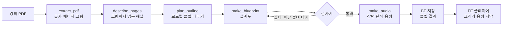

# EIDOS (에이도스)


**강의 PDF를 학습 단계별 숏폼 강의 시리즈로.**
강의 PDF를 올리면 입문 · 기본 · 심화 단계에 맞춰 개념과 예시 단위의 세로 숏폼 클립을 만들고, 쇼츠처럼 넘겨 보며 옆에서 원본 페이지로 근거를 확인한다.

ENDPoinT 해커톤 2026 · Team 19 · 발표 자료: [docs/presentation/EIDOS.pdf](docs/presentation/EIDOS.pdf)

## 바로 보기

**<https://2026endpoint.github.io/team19/>**

- **학습 예시**: 실제로 생성한 클립을 서버 없이 언제든 재생할 수 있다.
  - 알고리즘 3장 분할정복(57쪽): 입문 4개, 기본 10개
  - 경제의 이해 10장(10쪽): 입문 2개, 기본 3개, 심화 4개
- **PDF 업로드 → 생성**: 지금은 팀 토큰으로 운영한다. 팀장 노트북 서버가 켜져 있을 때만 동작하고(Cloudflare 임시 터널), 업로드마다 실제 유료 AI를 호출하니 시험은 짧은 PDF로 부탁드린다.

## 왜 만들었나

- **현실**: 롱폼도 귀찮은 시대에 공부는 더 막막하다. 강의는 길고, 이어져 있고, 양이 많다.
- **아이디어 1**: 강의도 숏폼으로. 개념 하나, 예시 하나 단위로 잘라 쇼츠처럼 넘겨 본다.
- **아이디어 2**: 글은 줄이고 그림으로. 배열이 바뀌고, 포인터가 움직이고, 수식의 항이 강조된다.
- 기준은 유튜브의 일반 영상이 아니라 **내 수업의 강의자료**다. 시험은 결국 강의자료에서 나온다.

## 기존 서비스와의 차이

비슷한 시도는 있지만 잘 알려지지 않았고, 한국어로 강의 전체를 숏폼 시리즈로 만들어 주는 서비스는 아직 빈자리다.

| 서비스 | 하는 일 | 한계 |
|---|---|---|
| NotebookLM Short Video | 자료에서 개념 하나 → 약 60초 세로 영상 | 한 번에 하나. 출시 당시 영어 전용, 18세 이상, 요금제에 따라 제한 |
| Lectone | PDF·PPT → 스크립트 + AI 음성 | 슬라이드에 음성만 입힘 |
| Shortd | PDF → 요약 릴스, 플래시카드 | 서비스 종료 |
| UnivAI, Gpai 등 | 강의자료 글 요약 | 영상은 만들지 않음 |
| **EIDOS** | 강의 전체 → 개념·예시 시리즈, 넘겨 보기, 원본 근거 | 한국어, 학습 단계별 |

## 학습 단계 모드: 입문 · 기본 · 심화

공부는 어떤 단계로 나눠야 효율적일까에서 출발했다.

| | 입문 | 기본 | 심화 |
|---|---|---|---|
| 언제 | 처음 접할 때 → 큰 그림 | 복습할 때 → 개념 하나씩 | 시험 직전 → 지엽까지 |
| 다루는 범위 | 목차 수준 + 일반 지식 | 강의 전체 | 강의의 90~100% |
| 설명 | 무엇인지, 왜 필요한지, 비유로 쉽게 | 강의 내용 절반 + AI의 쉬운 풀이 절반 | 조건, 예외, 표기, 증명까지. 근거 페이지 90% 이상 반영 검사 |
| 클립 | 40~70초, 최대 5개 | 1~1.5분 | 1~2분 |

**실제 예 (분할정복 57쪽)**: 같은 강의가 입문에서는 4개(“큰 문제를 작게 나누어 해결하기” …), 기본에서는 10개(“분할 정복의 세 단계와 종료 조건”, “예시: 피봇 8로 제자리 분할하기” …)의 시리즈가 된다.

## 영상을 ‘생성’하지 않고 ‘설계’한다

AI는 영상을 직접 만들지 않고 클립마다 **설계도(JSON)** 를 쓴다. 브라우저가 그 설계도를 음성, 자막과 맞춰 그린다.

```json
{ "line": 1, "do": "swap", "target": "arr", "args": ["0", "4"] }
```

| | 영상 생성 AI | EIDOS |
|---|---|---|
| 숫자 · 수식 · 코드 | 뭉개짐 | 정확히 그림 |
| 고치기 | 처음부터 다시 | 설계도 한 줄 수정 |
| 생성 방법 | 멀티모달 모델로 영상 생성 | 브라우저에서 설계대로 그림 |
| 비용 | 큼 | 클립당 센트 단위 |
| 특징 | 자료를 안 넣으면 범용, 넣으면 자료만 해설 | 특별한 프롬프트 없이 모드별로 자료를 참고해 반영 |



- **설계도** = 장면의 목록. 장면 = 문장 + 부품 + 동작
- **부품 5개**: 글, 원본 조각, 다이어그램(row · column · tree · cycle · layers), 격자, 코드
- **동작 17개**: show, highlight, swap, move, markLine, stamp(X/O), place, attach, divide … ([docs/04](docs/04-video-blueprint.md))
- **모델**: 해설·분할·설계도 GPT-6.1 Sol(영어 시스템 프롬프트), 음성 gpt-4o-mini-tts(cedar)

## 역할별로 한 일

### AI · 조강현
- **파이프라인**: 추출 → 페이지 해설 → 모드별 클립 나누기 → 설계도 + 검사기 → 장면 단위 음성 ([pipeline/](pipeline/), [contracts/pipeline.md](contracts/pipeline.md))
- **검사기**: 형식 · 자리 · 크기 · 겹침 검사, 틀리면 이유를 붙여 다시 만들게 함. FE가 구현한 기능만 켜는 기능 스위치, 문체 검사, 심화 반영률 검사
- **실험**: 강의자료 조사로 부품 결정, 모델 비교(Sonnet · Terra · Sol · Haiku → Sol), 프롬프트 언어(영어: 입력 토큰 약 10%↓), 음성(cedar, 장면 단위 생성으로 톤 통일), 클립 나누기, 여러 과목 평가(CS와 경제의 이해 등 교양), 참고 숏폼 비교, near 비교
- **제안서 13개**: 설계도 형식 v0, 과목별 평가 세트, 읽기 원고(speech), 내 강의함(기기 ID), `**단어**` 강조, X/O 도장, 글자만 있는 노드, 쌓이는 연출(place), 입문 · 기본 · 심화, 부품 옆 글(near), 격자 구분선

### FE · 정혜원
- **강의자료에서 시작하는 학습 화면**: PDF 업로드(최대 100쪽) → 모드 선택 → 클립 목록 → 세로 플레이어
- **배열과 코드를 따라가는 학습**: 배열 · 포인터 · 구분선, 코드 줄과 실제 예시 값
- **원본 근거를 옆에서 바로 확인**: 클립 재생과 PDF 원본을 한 화면에
- **과목에 맞게 바뀌는 시각화**: 관계와 순서(다이어그램), 수식과 핵심 항 강조(KaTeX)
- **값의 이동이 보이는 배열 애니메이션**: 피봇을 기준으로 위치가 바뀌는 과정
- 쇼츠식 위아래 넘기기, 내 강의함 · 삭제, 실패 클립 다시 만들기 ([frontend/](frontend/))

### BE · 김하형
- **API · 작업 관리**: PDF 업로드 · 100쪽 검증, AI 연동 · 모드별 클립 생성, 작업 상태 조회 · 결과 · 음성 제공, 최대 3개 동시 실행 · 재시도
- **안정성 · 예외 처리**: 중복 실행 · 중복 과금 방지, 재시작 후 유료 자동 재호출 차단, HTTP 오류 코드 · 상태 관리, 영구 삭제 실패 시 복구
- **데이터 · 사용자 관리**: SQLite + 로컬 파일 저장, SHA-256 동일 PDF 재사용, 기기별 강의함 · 영구 삭제, AI 토큰 · 비용 사용량 기록
- 제안서 3건(API · AI 파이프라인 계약, 영구 삭제 · 실패 복구 설계), BE · AI 테스트 451개 통과 ([backend/](backend/), [contracts/api.md](contracts/api.md))

## 개발 방식: 저장소가 에이전트들의 대화방

3명이 각자 AI 에이전트(Claude Code, Codex)와 개발했다. 에이전트끼리는 직접 대화할 수 없어서 **저장소 파일을 채널로** 썼다.

제안서([proposals/](coordination/proposals/)) → 다른 역할 에이전트가 자기 칸에 의견 → 팀장이 결정·기록([decisions.md](coordination/decisions.md)) → 계약 문서·코드 반영

**결정 69개 · 제안서 31개(AI 13 · FE 15 · BE 3) · 계약 문서 4개(API · 데이터 · 파이프라인 · 설계도)**. 규칙은 [AGENTS.md](AGENTS.md), 사람용 설명은 [docs/08](docs/08-collaboration.md)에 있다.

## 실제 서비스로 전환한다면

| 할 일 | 지금 |
|---|---|
| 클라우드 배포 | 노트북 + 임시 터널 |
| 모바일 웹 | PC 화면 기준. 세로 숏폼에 맞게 FE 추가 구현 필요 |
| 로그인 · 보안 | 기기 ID 구분, 인증 아님 |
| 체험 + 구독 결제 | 팀 크레딧으로 비용 부담 |
| 긴 PDF 자동 분할 | 100쪽 제한 |
| 다시 만들기 요청 | “이 클립을 이렇게 다시” 요청, MP4 내보내기 미구현 |
| 자동 정리 · 비용 상한 | 오래된 자료 정리, 사용자별 사용량 한도 없음 |
| 음성 모델 교체 | 지금 TTS 모델 2027년 1월 종료 예정 |

## 기술 스택

- **FE**: React 19, TypeScript, Vite, Tailwind CSS, KaTeX
- **BE**: Python, FastAPI, SQLite, 로컬 파일 저장, 작업 큐 동시 실행 3개
- **AI**: Python 모듈, OpenAI API, 설계도 검사기
- **공개 페이지**: GitHub Pages(FE) + Cloudflare 임시 터널(BE) ([.github/workflows/pages.yml](.github/workflows/pages.yml))

## 직접 실행하기

Python 3.13+, Node 22+가 필요하다. Windows PowerShell 기준이다.

```powershell
# 1. 서버 (샘플 모드: AI를 부르지 않고 저장된 결과로 동작)
python -m venv .venv
.venv\Scripts\python -m pip install -r backend/requirements.txt -r pipeline/requirements.txt
$env:AI_MODE = 'sample'
.venv\Scripts\python -m uvicorn backend.app:app --host 127.0.0.1 --port 8000

# 2. 화면 (다른 터미널)
cd frontend
npm install
npm run dev        # http://localhost:5173
```

실제 AI로 생성하려면 저장소 맨 위 `.env`에 `OPENAI_API_KEY=...`를 넣고 `AI_MODE=real`로 켠다. 모델은 `AI_DESCRIBE_MODEL`, `AI_OUTLINE_MODEL`, `AI_BLUEPRINT_MODEL`로 바꿀 수 있다. 서버 세부 설정은 [backend/README.md](backend/README.md)에 있다.

## 폴더 구조

```text
frontend/      화면과 설계도 플레이어 (FE)
backend/       API 서버, 작업 실행, 저장 (BE)
pipeline/      추출·해설·분할·설계도·음성, 검사기, 프롬프트 (AI)
samples/       실제로 생성한 결과 (학습 예시, 샘플 모드)
contracts/     파트 사이 약속: API, 데이터 모양, AI 파이프라인
docs/          제품, 구조, 설계도 형식, 모드, 비용, 일정, 발표 자료
coordination/  결정 기록, 질문, 제안서, 역할별 현황
```

모델 비교, 음성 실험, 평가 클립 같은 실험 코드와 기록은 [`archive/experiments` 브랜치](https://github.com/2026ENDPoinT/team19/tree/archive/experiments)에 보관했다.

| 문서 | 내용 |
|---|---|
| [01 제품](docs/01-product.md) | 무엇을 왜 만드는지, 구현 범위 |
| [02 유사 서비스](docs/02-competition.md) | 비교와 차별점 |
| [03 구조](docs/03-architecture.md) | 전체 흐름과 구성 |
| [04 영상 설계도](docs/04-video-blueprint.md) | AI ↔ FE 형식 (부품 5개, 동작 17개) |
| [05 분할과 모드](docs/05-segmentation-and-modes.md) | 클립을 나누는 기준, 입문·기본·심화 |
| [06 비용](docs/06-cost-and-budget.md) | 가격, 실측 비용 |
| [07 일정](docs/07-schedule.md) | 사전 개발과 해커톤 14시간 |
| [용어집](docs/glossary.md) | 처음 보는 단어 |

## 팀

| 역할 | 이름 |
|---|---|
| 팀장 · AI | 조강현 |
| 프론트엔드 (FE) | 정혜원 |
| 백엔드 (BE) | 김하형 |

학습 예시에는 강의 슬라이드 그림이 포함되어 있다. 문제가 되면 연락 주시면 내린다.
