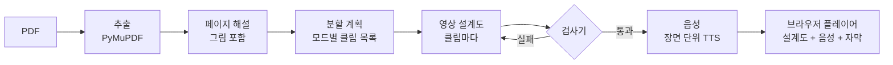

# EIDOS (에이도스)

**강의 PDF를 올리면, 학습 단계에 맞춰 개념과 예시 단위로 나눈 세로 숏폼 강의 시리즈를 만들어 주는 웹 서비스.**
쇼츠처럼 위아래로 넘겨 보고, 옆에는 그 장면이 근거로 삼은 원본 페이지가 함께 뜬다.

ENDPoinT 해커톤 2026 · Team 19

## 바로 보기

**<https://2026endpoint.github.io/team19/>**

- **학습 예시**: 알고리즘 3장 "분할정복" 강의로 실제 생성한 클립 14개(입문 4, 기본 10)가 맨 앞에 있다. 서버 없이 언제든 재생된다.
- **PDF 업로드 → 생성**: 팀장 노트북의 서버가 켜져 있는 동안에만 동작한다(Cloudflare 임시 터널). 업로드마다 실제 유료 AI를 호출하니 시험은 짧은 PDF로 부탁드린다.
- 발표 자료: (추가 예정)

## 무엇이 다른가

1. **강의 전체를 개념·예시 단위 시리즈로 자동 분할한다.** 한 번에 영상 하나가 아니라, 강의 하나가 클립 여러 개가 된다.
2. **학습 단계 모드 3개.** 입문(목차 수준, 클립 40~70초, 최대 5개), 기본(강의 전체를 강의 내용 절반 + AI의 쉬운 풀이 절반), 심화(강의의 90~100%). 모드마다 나누는 방식, 클립 수, 말투가 다르다.
3. **영상 생성 AI가 아니라 코드로 그린다.** AI는 "영상 설계도"(장면, 부품, 동작을 적은 JSON)만 쓰고 브라우저가 그린다. 배열 교환, 포인터 이동, 수식 항 강조, 코드 줄 따라가기가 뭉개지거나 틀어지지 않는다.
4. **근거 원본 페이지.** 모든 장면이 PDF의 어느 쪽에서 왔는지 옆 패널로 바로 확인한다.
5. **한국어.** 내레이션, 자막, 숫자 읽기(값은 "십사", 개수는 "열한 개")까지 한국어에 맞췄다.

## 어떻게 만들어지나



| 단계 | 하는 일 | 사용 |
|---|---|---|
| 추출 | 쪽마다 글자와 페이지 그림. 100쪽까지 | PyMuPDF (무료) |
| 페이지 해설 | 그림·도식까지 읽어 쪽마다 설명 | GPT-6.1 Sol |
| 분할 계획 | 모드에 맞춰 클립 목록, 근거 페이지 | GPT-6.1 Sol |
| 설계도 | 장면, 내레이션, 부품(글·격자·다이어그램·코드·원본 조각), 동작 17개 | GPT-6.1 Sol + Python 검사기 |
| 음성 | 장면 하나를 한 번에 읽혀 톤을 맞추고 문장별로 자름 | gpt-4o-mini-tts (cedar) |
| 재생 | 음성 시간에 맞춰 화면을 계산해 그림. 되감기·탐색해도 같은 화면 | React |

**실측 비용** (분할정복 57쪽, 11/14): 페이지 해설 $0.30(강의당 한 번), 입문 4클립 $0.31, 기본 10클립 $1.08. 자세히는 [docs/06](docs/06-cost-and-budget.md).

## 기술 스택

- **FE**: React 19, TypeScript, Vite, Tailwind CSS, KaTeX ([frontend/](frontend/))
- **BE**: Python, FastAPI, SQLite, 로컬 파일 저장, 작업 큐 동시 실행 3개 ([backend/](backend/))
- **AI**: Python 모듈, OpenAI API, 설계도 검사기 ([pipeline/](pipeline/))
- **공개 페이지**: GitHub Pages(FE) + Cloudflare 임시 터널(BE) ([.github/workflows/pages.yml](.github/workflows/pages.yml))

## 직접 실행하기

Python 3.13+, Node 22+가 필요하다. Windows PowerShell 기준이다.

```powershell
# 1. 서버 (샘플 모드: AI를 부르지 않고 저장된 결과로 동작)
python -m venv .venv
.venv\Scripts\python -m pip install -r backend/requirements.txt -r pipeline/requirements.txt
$env:AI_MODE = 'sample'
.venv\Scripts\python -m uvicorn backend.app:app --host 127.0.0.1 --port 8000

# 2. 화면 (다른 터미널)
cd frontend
npm install
npm run dev        # http://localhost:5173
```

실제 AI로 생성하려면 저장소 맨 위 `.env`에 `OPENAI_API_KEY=...`를 넣고 `AI_MODE=real`로 켠다. 모델은 `AI_DESCRIBE_MODEL`, `AI_OUTLINE_MODEL`, `AI_BLUEPRINT_MODEL`로 바꿀 수 있다. 서버 세부 설정은 [backend/README.md](backend/README.md), AI 함수와 오류는 [contracts/pipeline.md](contracts/pipeline.md)에 있다.

## 폴더 구조

```text
frontend/      화면과 설계도 플레이어 (FE)
backend/       API 서버, 작업 실행, 저장 (BE)
pipeline/      추출·해설·분할·설계도·음성, 검사기, 프롬프트 (AI)
samples/       실제로 생성한 결과 (학습 예시, 샘플 모드)
contracts/     파트 사이 약속: API, 데이터 모양, AI 파이프라인
docs/          제품, 구조, 설계도 형식, 모드, 비용, 일정
coordination/  결정 기록, 질문, 제안서, 역할별 현황
```

모델 비교, 음성 실험, 평가 클립 같은 실험 코드와 기록은 [`archive/experiments` 브랜치](https://github.com/2026ENDPoinT/team19/tree/archive/experiments)에 보관했다(11/14).

## 팀

| 역할 | 이름 |
|---|---|
| 팀장 · AI | 조강현 |
| 프론트엔드 (FE) | 정혜원 |
| 백엔드 (BE) | 김하형 |

## 이 저장소가 돌아간 방식

세 명이 각자 AI 코딩 에이전트(Claude Code, Codex)와 함께 일했다. 에이전트끼리는 직접 대화할 수 없어서 **이 저장소의 파일이 대화 채널**이었다. 질문은 [questions.md](coordination/questions.md), 기능 제안은 [proposals/](coordination/proposals/), 결정은 [decisions.md](coordination/decisions.md)(D-01~D-69)에 남기고, 다른 사람의 에이전트가 다음 세션에서 읽고 답했다. 규칙은 [AGENTS.md](AGENTS.md), 사람용 설명은 [docs/08](docs/08-collaboration.md)에 있다.

| 문서 | 내용 |
|---|---|
| [01 제품](docs/01-product.md) | 무엇을 왜 만드는지, 구현 범위 |
| [02 유사 서비스](docs/02-competition.md) | 비교와 차별점 |
| [03 구조](docs/03-architecture.md) | 전체 흐름과 구성 |
| [04 영상 설계도](docs/04-video-blueprint.md) | AI ↔ FE 형식 (부품 5개, 동작 17개) |
| [05 분할과 모드](docs/05-segmentation-and-modes.md) | 클립을 나누는 기준, 입문·기본·심화 |
| [06 비용](docs/06-cost-and-budget.md) | 가격, 실측 비용 |
| [07 일정](docs/07-schedule.md) | 사전 개발과 해커톤 14시간 |
| [용어집](docs/glossary.md) | 처음 보는 단어 |

## 알려진 한계

- 스캔 PDF(글자가 그림인 자료)와 손글씨 필기는 품질을 보장하지 않는다.
- 100쪽을 넘는 PDF는 받지 않는다. 필요한 부분만 나눠서 올린다.
- 공개 페이지의 업로드는 팀장 노트북이 켜져 있을 때만 된다. 해커톤 뒤 배포는 클라우드 서버로 다시 정한다.
- 학습 예시에는 강의 슬라이드 그림이 포함되어 있다. 문제가 되면 연락 주시면 내린다.
