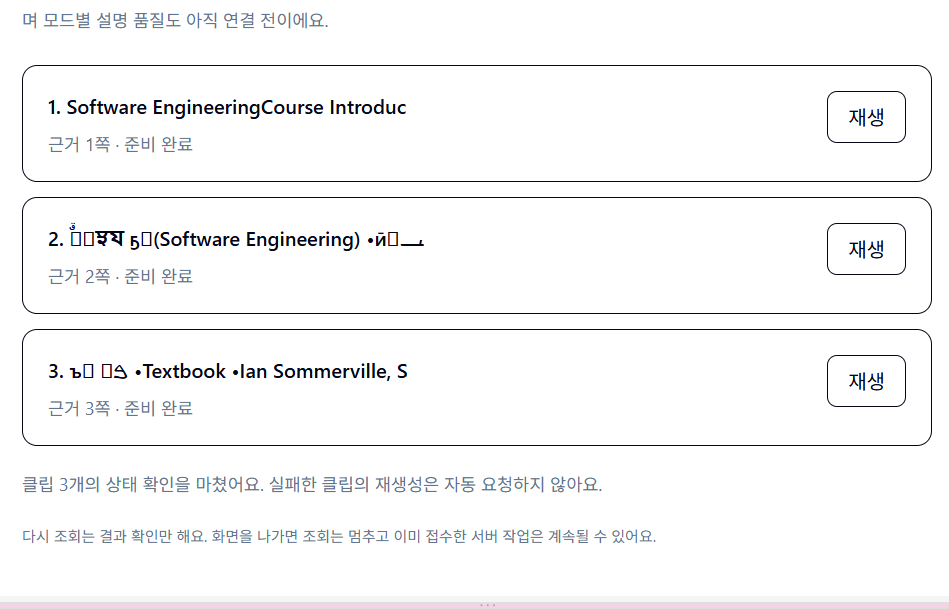

# BUG-FE-01 · PDF 업로드 후 클립 목록의 한글 깨짐

> 상태: 조사 중 · 담당: FE(기록), BE·AI(원인 조사 요청) · 최종 수정: 2026-11-13 · FE/Codex

## 발생 정보
- 발생 관찰: **2026-11-12 15:47경(KST)**. 사용자 제공 스크린샷 파일명 `스크린샷 2026-11-12 154714.png` 기준이며 서버 로그 시각은 미확인이다.
- 접수 자료 확정: 2026-11-13 사용자가 당시 업로드한 파일을 `01_course_intro.pdf`라고 명시했다.
- 화면: PDF 업로드·준비 완료·모드 선택 후 학습 클립 목록. 근거 1~3쪽의 클립이 ‘준비 완료’로 표시된 상태다.
- 당시 흐름: FE 개발용 샘플 연결 화면. 실제 AI 생성 결과 화면이 아니다. 선택 모드, lectureId/jobId, 당시 서버 버전·로그는 미확인이다.

## 원본과 증거
- 원본 PDF: `01_course_intro.pdf` (소프트웨어공학).
- 제공된 로컬 위치: `C:/3학년/소프트웨어공학/01_course_intro.pdf`.
- 파일 크기: 1,669,339 bytes.
- SHA-256: `4d3e38bb36b6343c04713206a5bb51783f7977feb1ded125d23893583a74ca82`.
- 원본 PDF는 변경하거나 Git에 복제하지 않았다. 팀원의 PC에는 위 로컬 경로가 없으므로 실제 파일 전달은 별도로 필요하다. 이전 조사에 쓰인 `05_architecture_design_impl.pdf`와 같은 파일로 취급하지 않는다.

## 실제 증상과 기대 동작
- 2·3번째 클립 제목에서 한글로 예상되는 부분이 읽을 수 없는 문자로 보인다. 정확한 문자는 이미지에서 임의 전사하지 않는다.
- 1번째 제목은 `Software EngineeringCourse Introduc`처럼 단어 사이 공백이 붙고 문장이 잘려 있다.
- 기대: 원문 한글을 정상 추출·보존하고 읽을 수 있는 제목을 표시한다. 복구 불가능한 경우 명확한 안내를 표시한다.
- 별도 기능 요청: 실제 개념 추출 결과는 한국어 개념명으로 보여 달라는 사용자 요청이 있다. **영어 발췌 제목과 한글 문자 손상은 별개 문제**다.

## 재현 절차(당시 흐름 기준, 재검증 전)
1. 샘플 모드 BE와 FE를 실행한다.
2. 위 SHA-256의 PDF를 업로드하고 준비 완료까지 기다린다.
3. 학습 모드를 선택하고 클립 준비를 요청한다(당시 선택한 모드는 미확인).
4. 근거 2·3쪽의 제목을 원본 PDF와 비교한다. 1쪽의 공백·35자 잘림도 별도로 확인한다.
5. 현재 FE는 제목을 ‘자료 N쪽 · 샘플 클립’으로 바꿨으므로 ‘PDF 추출 원문 확인’을 펼쳐 원래 API title을 확인한다. 제목 대체는 원인 복구가 아니다.

## 예상 담당 영역 · 확정 원인 아님
- **[to:BE] 1차 조사:** 샘플 경로 `backend/pdf_text_fallback.py`의 pypdf 추출 → DB pages.text → 샘플 plan_outline → outline API title을 이 PDF의 1~3쪽에서 비교해 주세요. 저장·전송 중 손상인지 추출 시점 손상인지 구분이 필요합니다.
- **[to:AI] 공동 조사:** 원본 페이지의 실제 한글과 글꼴 매핑, 실제 파이프라인 추출 결과를 대조해 주세요. 한국어 개념명 생성은 별도 기능으로 확인해 주세요.
- **[to:FE] 표시 확인:** API title을 그대로 표시한 화면이었다. API 값이 정상인데 화면만 깨진다는 증거가 나오면 FE 렌더링·폰트를 조사한다. 현재 단계에서 FE 원인으로 확정하지 않는다.
- 확인된 코드 동작: 샘플 제목은 추출 문자열의 공백을 정리한 첫 35자이며 blueprint.title은 추가로 20자로 자른다. 잘림은 샘플 구현의 한계지만 한글 깨짐을 설명하는 확정 원인은 아니다.
- 기존 조사·팀 답변은 [questions.md의 Q-FE-08 항목](../questions.md)을 참고한다. 기존의 다른 PDF·합성 PDF 조사 결과만으로 이 원본의 원인을 확정하지 않는다.

## 현재 대응과 완료 기준
- FE 임시 대응: 읽을 수 있는 한국어 샘플 제목을 표시하고 추출 원문은 펼침 영역에 보존했다. 깨짐은 미해결이다.
- 완료 기준: 이 PDF 2·3쪽의 원문·추출·저장·API·화면을 비교해 원인과 수정 전후 증거를 남긴다. 1쪽 공백 문제와 제목 잘림은 별도로 판정한다.
- 수정 후 기존 깨진 자료의 재처리 방법도 BE가 안내한다. 재업로드만으로 개선된다고 보장하지 않는다.
- 이번 작업은 버그 접수·증거 정리다. PDF 추출 실행·브라우저 재현·유료 AI 호출·다른 역할 코드 수정은 하지 않았다.

## 추가 보고 · 2026-11-13
- **사용자 전달:** BE 담당자는 업로드해도 한글 깨짐이 보이지 않는다고 했다. BE가 확인한 파일·화면·실행 모드와 추출 원문은 아직 전달받지 못했다. ‘재현되지 않음’ 보고이며 ‘해결됨’으로 판정하지 않는다.
- **FE 코드 확인:** 현재 목록 제목은 원래 API title 대신 ‘자료 N쪽 · 샘플 클립’을 표시한다. 원래 title은 ‘PDF 추출 원문 확인’ 안에 있다. 따라서 기본 목록에서 깨짐이 보이지 않는 것만으로 추출 복구를 확인할 수 없다. 이것이 BE 관찰의 원인인지는 미확인이다.
- **[to:BE] 비교 확인 요청:** 같은 `01_course_intro.pdf`(위 SHA-256)를 사용했는지 확인하고, 2·3쪽 항목의 ‘PDF 추출 원문 확인’을 펼쳤을 때도 정상인지 알려 주세요. 가능하면 API `clips[].title`과 DB `pages.text`도 원본 PDF에 대조해 주세요. FE 표시 대체 여부와 실제 텍스트 복구를 구분하려는 요청입니다.
- 확인 당시 `AI_MODE`(sample/real), 추출기·버전, 코드 버전, 신규 업로드인지 기존 저장 결과인지도 함께 알려 주세요. 원문이 정상이라면 이 조건들을 발생 당시와 비교합니다. 실제 모드 유료 호출을 새로 실행하라는 요청은 아닙니다.

## FE 임시 제목 대체 철회 · 2026-11-13
- 사용자 요청으로 `frontend` 브랜치에서 ‘자료 N쪽 · 샘플 클립’ 대체 제목과 ‘PDF 추출 원문 확인’ 펼침 영역을 제거했다. API `clips[].title`을 목록 제목에 그대로 표시한다. 긴 제목은 줄바꿈만 적용하며 문자 치환·복구·번역을 하지 않는다.
- 위 재현 절차 5번과 추가 보고의 ‘펼쳐서 확인’은 이전 UI 기준이다. 이 변경이 적용된 화면은 2·3쪽 제목 자체를 확인하면 된다. 아직 미커밋이며 main에는 미반영이므로 비교할 때 사용 중인 브랜치·버전을 확인한다.
- FE 대체 표시가 조사에 혼선을 줄 수 있어 철회했다. 이 변경도 한글 추출 오류 해결은 아니며 상태는 조사 중이다.

- **반영 갱신 (2026-11-13):** 위 임시 표시 철회 코드(`7ac99ca`)를 사용자 승인으로 main에 병합했다. 위의 미커밋·main 미반영 설명은 작성 당시 상태이며 현재는 main에서도 API title을 직접 표시한다. 한글 추출 오류 자체는 여전히 조사 중이다.
