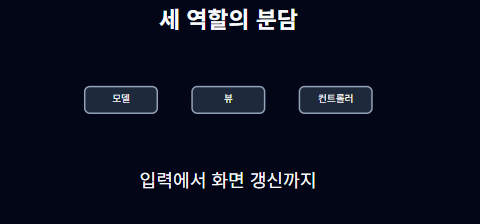
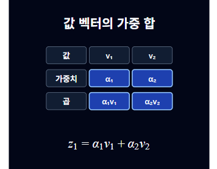
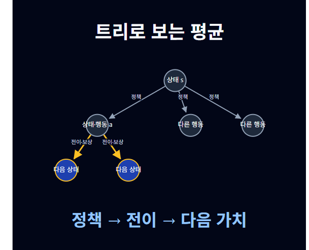
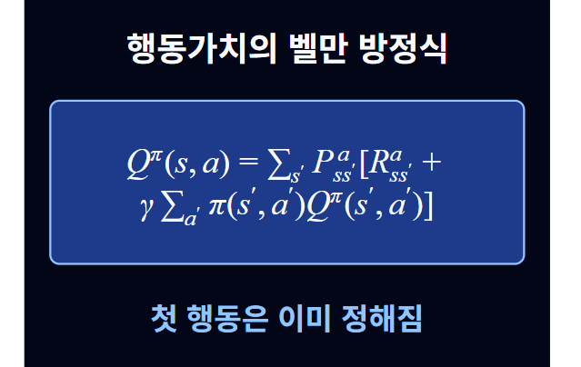
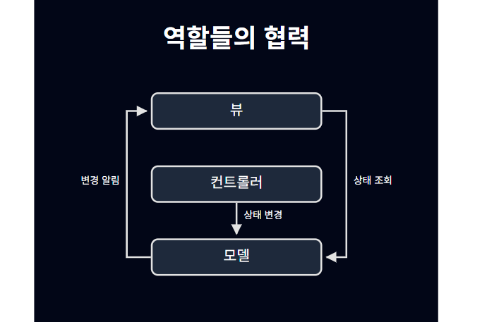
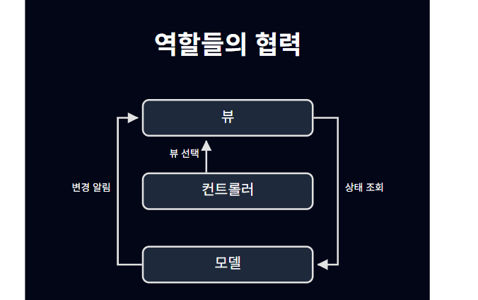

# 다른 과목 평가 클립 · 사용자 화면 피드백

> 상태: 사용자 검토 결과 · 담당: FE · 최종 수정: 2026-11-13 · FE/Codex

정혜원이 FE 평가 플레이어에서 Terra 결과 5개를 확인해 전달한 의견이다. 코드 기반 자동 검사와 구분한다. 전체 재생·탐색·음성 싱크 항목의 통과 보고는 아니며 에이전트가 브라우저를 대신 조작하지 않았다.

| 클립 | 사용자 의견 | 후속 |
|---|---|---|
| 알고리즘 | 잘 작동함 | 추가 문제 보고 없음 |
| 소프트웨어공학 | 가로 배치로 작아 가독성이 떨어짐. column과 다른 배치 활용 요청 | [to:AI] 의미에 맞는 배치 선택·검사기 지원을 검토. [to:FE] 해당 배치 렌더링 지원 |
| 트랜스포머 | 수식·그림을 잘 이해한 것 같음 | 추가 문제 보고 없음 |
| 강화학습 | 트리 글자가 노드를 벗어남. 수식이 나열돼 가독성이 낮고 이해하기 어려움 | [to:FE] 노드 라벨 넘침 개선. [to:AI] 수식 단계 분해·항별 강조·설명 순서 검토 |
| 파이썬 | 잘 작동함 | 추가 문제 보고 없음 |

## 문제 장면과 증거
- **MVC:** `eval-se-arch-c2-terra`, s2 ‘세 역할의 분담’, diagram `d_roles`, layout row. 저장 captions 기준 장면 시작 20.1초. 아래 시각은 캡처 순간을 확정한 값이 아닌 장면 시작 참고값이다. s3(40.05초), s4(60.55초)도 row라 연관 점검이 필요하다. 캡처에는 세 상자가 보이고 연결선은 보이지 않지만, 그 순간 숨김/등장 동작의 정상 상태인지는 별도 확인해야 한다.

- **트랜스포머:** 값 벡터의 가중 합 장면. 사용자 긍정 평가 예시다.

- **강화학습 트리:** `eval-rl-mdp-c4-terra`, s3 ‘트리로 보는 평균’, diagram `d3_tree`, 장면 시작 49.95초. 라벨이 원형 노드 경계를 넘고 일부가 겹쳐 읽기 어렵다. FE의 글자 줄바꿈·노드 크기·간격 조정 대상이며 AI 원인으로만 돌리지 않는다.

- **강화학습 수식:** 같은 결과 s4 ‘행동가치의 벨만 방정식’, 장면 시작 72.75초. 수식 렌더링 자체는 보이지만 사용자는 항들이 나열돼 이해하기 어렵다고 보고했다. 수식의 수학적 오류나 KaTeX 파싱 실패를 확인한 보고는 아니다. AI는 의미를 유지한 단계별 제시를, FE는 수식 배치·크기를 검토한다.

## 배치 지원과 협업
FE row/column/tree 구현 여부와 AI가 해당 형식을 실제로 선택하는지는 별개다. 현재 column은 FE 구현, 공식 AI 검사기는 row/tree만 허용한다(P-FE-06). cycle/layers는 FE 미구현이다. [to:AI] 필요한 장면을 기준으로 column 공식 지원 및 cycle/layers 활용을 검토해 주세요(Q-FE-09). 저장된 samples나 타 역할 코드는 FE가 임의로 변경하지 않는다.

FE 내부 가독성 수정은 FE가 진행할 수 있다. 생성 규칙·검사기·형식 의미가 바뀌면 AI와 맞추고 팀 결정 절차를 따른다. BE는 API·저장/제공에 영향이 있을 때만 참여하면 된다. 이후 실제 시청 검토는 AI 담당자도 수행할 수 있으며 FE 담당자 개인의 시청을 필수 선행 조건으로 두지 않는다.

## FE 코드 수정 · 2026-11-13
- frontend 브랜치에서 노드 라벨을 여러 줄로 나누고, 원형/사각형 크기와 노드 간격·화살표 경계를 함께 계산하도록 수정했다. 긴 라벨은 원 밖으로 그대로 출력하지 않는다. 숨김 여부로 배치가 흔들리지 않게 전체 구조로 계산한다.
- 실제 강화학습 s3 데이터의 라벨 보존·노드 경계·노드 간 비겹침·숨김 위치 유지를 테스트했다. FE 테스트 13개와 빌드가 통과했다. 이전 리팩토링에서는 첫 화면 렌더링도 확인했다. 이번 수정 후 브라우저 가독성 재확인은 아직이다.
- MVC의 AI 배치 선택, column 공식 지원, cycle/layers와 강화학습 수식 설명 변경은 Q-FE-09의 공동 검토 대상으로 남긴다. FE가 원본 설계도를 임의 변경하지 않았다. 코드는 frontend에 공유하며 main 병합은 별도다.

## 추가 피드백 · 설명 종료 후 연결선 유지 (2026-11-13)
사용자는 같은 MVC 장면에서 다음 설명으로 넘어갈 때 기존 화살표가 사라지지 않기를 요청했다. 원하는 동작은 한 번 나타난 연결선을 장면 끝까지 회색으로 남기고 설명 중인 선만 강조하는 것이다. 장면 자체 전환 시 제거는 별개다.

설계도 확인: `samples/eval/se-arch-review-c2/result-terra.json`의 s3에서 line 3은 `s3_event`를 hide하고 `s3_query`를 show하며, line 4는 `s3_change`를 hide하고 `s3_select`를 show한다. 화면은 이 지시대로 동작한다. AI 프롬프트의 ‘동시에 보이는 관계선 3개 이하’ 규칙이 있는 상태다. FE 우회 선 구현만으로 hide 지시는 바뀌지 않는다.

[to:AI] Q-FE-12대로 동일 장면의 기존 선은 유지하고 show/highlight/unhighlight로 설명 대상을 구분하도록 규칙·평가 결과를 검토해 주세요. FE가 hide 계약을 무시하거나 원본 samples를 수정하지는 않았다. 캡처 시각은 파일명 기준이며 정확한 클립 재생 초는 미확인이다.
