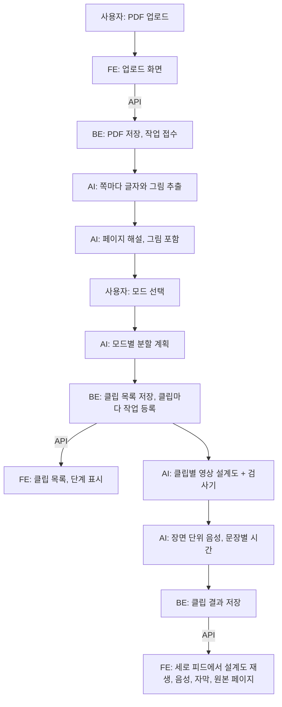

# 03. 전체 구조

> 상태: 확정 (해커톤 제출 기준) · 담당: 전원 (정리: AI) · 최종 수정: 2026-11-14 · AI/Claude

이 문서는 "무엇이 어떤 순서로 일하는가"를 다룬다. 기술 스택은 D-17이다: 서버와 AI는 Python(FastAPI), 화면은 React(TypeScript, Vite).

## 큰 흐름

## 단계별 설명

| 단계 | 하는 일 | 담당 | 메모 |
|---|---|---|---|
| 1. 업로드 | PDF를 받아 저장하고 작업 번호를 준다. 같은 주인이 같은 PDF를 다시 올리면 기존 강의를 쓴다 | FE, BE | 100쪽까지(D-67), 크기 제한 없음 |
| 2. 추출 | 쪽마다 글자를 뽑고 원본 페이지 그림을 만든다 | AI (BE가 호출) | PyMuPDF, 무료. 57쪽 약 3초 |
| 3. 페이지 해설 | 페이지 그림을 6쪽씩 AI에 보내 도식·그래프까지 글로 설명 | AI | 강의마다 한 번(D-12) |
| 4. 분할 계획 | 모드에 맞춰 클립 목록, 근거 페이지, 핵심 메모를 만든다 | AI | 품질의 핵심. [05](05-segmentation-and-modes.md) |
| 5. 설계도 | 클립마다 장면, 내레이션, 부품, 동작을 쓴다. 검사기에 떨어지면 오류를 붙여 한 번 다시 만든다 | AI | [04](04-video-blueprint.md) |
| 6. 음성 | 장면을 한 번에 읽혀 톤을 맞추고 문장 사이 쉼에서 자른다(D-62). 문장별 시간 계산 | AI (D-13). BE는 호출, 저장, 재시도 | gpt-4o-mini-tts, cedar |
| 7. 저장 | 결과와 AI 사용량(토큰, 비용)을 저장한다 | BE | SQLite + 로컬 파일(D-25) |
| 8. 재생 | 음성의 현재 시간으로 화면 상태를 처음부터 다시 계산해 그린다 | FE | 되감기·탐색해도 같은 화면 |

- 모델: 해설·분할·설계도는 GPT-6.1 Sol(D-55), 설계도 시스템 프롬프트는 영어판(D-58). 환경변수로 바꿀 수 있다([contracts/pipeline.md](../contracts/pipeline.md)).
- 클립 작업은 동시에 3개까지 돈다(D-45). 음성은 한 클립 안에서 4문장(장면)씩 동시에 요청한다.

## 세 파트가 맞닿는 곳 (= 계약)

| 맞닿는 곳 | 무엇을 주고받나 | 문서 |
|---|---|---|
| FE ↔ BE | API (업로드, 상태 확인, 클립 목록, 클립 결과, 내 강의함, 재시도, 삭제) | [contracts/api.md](../contracts/api.md) |
| AI → FE | 영상 설계도 (장면, 부품, 동작) | [04](04-video-blueprint.md), [contracts/data-model.md](../contracts/data-model.md) |
| AI ↔ BE | 파이프라인 함수 5개, 오류 코드, 사용량 | [contracts/pipeline.md](../contracts/pipeline.md) |

## 오래 걸리는 일은 "작업"으로 처리

클립 생성에는 1~3분이 걸린다. 요청을 받으면 바로 작업 번호를 돌려주고, 화면은 약 3초마다 상태를 물어본다(폴링, D-21). 실패한 작업은 사용자가 그 클립만 다시 실행한다(`POST /jobs/{id}/retry`). 서버를 다시 켜면 돌던 작업은 실패(`SERVER_RESTARTED`)로 두고 유료 호출을 자동으로 다시 하지 않는다(D-44).

## 샘플 모드와 학습 예시

- `AI_MODE=sample`이면 AI를 부르지 않고 `samples/`의 저장된 결과로 같은 흐름이 돈다. FE와 BE는 키와 비용 없이 개발했다.
- `samples/eval/`의 실제 생성 결과는 FE 빌드에 함께 묶여 **학습 예시**로 나온다. 서버 없이 재생된다.

## 실행 환경

| 용도 | FE | BE | 결정 |
|---|---|---|---|
| 개발 | `npm run dev` (5173) | `uvicorn` (8000) | |
| 해커톤 시연 | 팀장 노트북 localhost | 팀장 노트북 localhost | D-66 |
| 제출용 공개 페이지 | GitHub Pages <https://2026endpoint.github.io/team19/> | 팀장 노트북 + Cloudflare 임시 터널 | D-69 |

- 공개 페이지는 main에 push하면 [pages.yml](../.github/workflows/pages.yml)이 빌드해 올린다. 터널 주소가 바뀌면 그 파일의 `VITE_API_BASE_URL`만 고친다.
- 해커톤 뒤 배포는 클라우드 서버로 다시 정한다(D-66).

## 보안

- API 키는 서버의 `.env`에만 둔다. 브라우저 코드와 저장소에 넣지 않는다.
- 내 강의함은 로그인 없는 기기 ID라 다른 사람의 강의는 목록에 나오지 않지만, 강의 ID를 알면 열린다(D-50). 개인 자료 보호 수준은 아니다.
- 공개 페이지의 업로드는 실제 유료 호출이다. 팀장이 참가자에게 자제를 부탁하는 것으로 감수했다(D-69).
