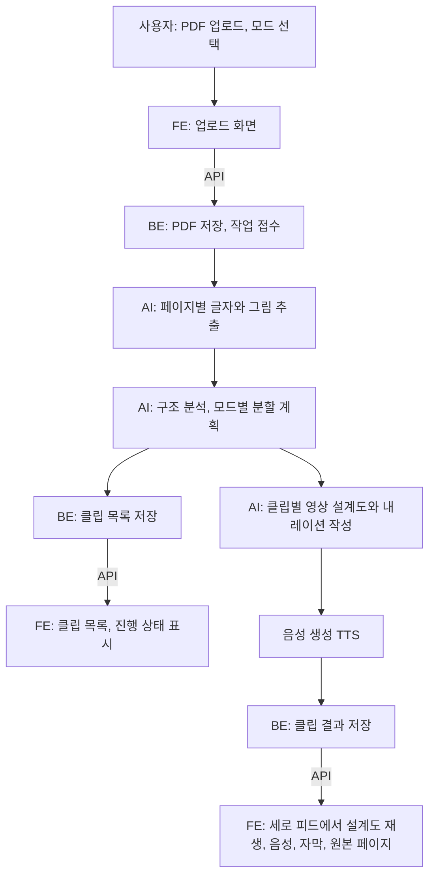

# 03. 전체 구조

> 상태: 초안 (기술 스택 미정) · 담당: 전원 (정리: AI) · 최종 수정: 2026-11-07 · AI/Claude

이 문서는 "무엇이 어떤 순서로 일하는가"만 다룬다. 어떤 언어와 도구로 만들지는 [P-AI-01 제안서](../coordination/proposals/P-AI-01-tech-stack.md)에서 정한다.

## 큰 흐름

## 단계별 설명

| 단계 | 하는 일 | 담당 | 메모 |
|---|---|---|---|
| 1. 업로드 | PDF를 받아 저장하고 작업 번호를 준다 | FE, BE | |
| 2. 추출 | 페이지마다 글자를 뽑고, 원본 페이지 그림(썸네일)을 만든다 | AI (또는 BE) | 비용이 들지 않는 로컬 처리 |
| 3. 분할 계획 | 자료 구조를 파악하고, 모드에 맞춰 클립 목록을 만든다 | AI | 품질의 핵심. [05](05-segmentation-and-modes.md) |
| 4. 설계도 | 클립마다 장면 목록, 내레이션, 근거 페이지를 만든다 | AI | [04](04-video-blueprint.md) |
| 5. 음성 | 내레이션을 음성으로 만들고 문장별 시간을 잰다 | AI (D-13). BE는 호출, 저장, 재시도 | |
| 6. 저장 | 결과를 저장해서 다시 볼 수 있게 한다 | BE | |
| 7. 재생 | 설계도를 보고 화면을 그리며 음성과 맞춘다 | FE | 가장 손이 많이 가는 부분 (Q-AI-22) |

## 세 파트가 맞닿는 곳 (= 계약)

| 맞닿는 곳 | 무엇을 주고받나 | 문서 |
|---|---|---|
| FE ↔ BE | API (업로드, 상태 확인, 클립 목록, 클립 결과) | [contracts/api.md](../contracts/api.md) |
| AI → FE | 영상 설계도 (장면, 부품, 동작) | [04](04-video-blueprint.md), [contracts/data-model.md](../contracts/data-model.md) |
| AI ↔ BE | 파이프라인을 어떻게 부르고 결과를 어떻게 돌려주는지 | 미정 (스택 결정 후) |

계약이 먼저 정해져야 세 명이 서로 기다리지 않고 동시에 일할 수 있다.

## 오래 걸리는 일은 "작업"으로 처리

클립 생성에는 수십 초에서 몇 분이 걸린다. 그래서 요청을 받으면 바로 작업 번호를 돌려주고, 화면은 그 번호로 진행 상태를 확인한다.
몇 초마다 물어보는 방식(폴링)과 서버가 알려주는 방식 중 무엇을 쓸지는 미정이다(Q-AI-19).

## 샘플 우선 개발

계약 v0이 정해지면 `samples/` 폴더에 샘플 결과(분할 계획, 클립 설계도, 음성)를 둔다. 손으로 만들거나 AI로 한 번 생성해서 저장한 것이다.

- FE는 샘플로 피드와 플레이어를 만든다. AI 결과를 기다리지 않는다.
- BE는 샘플로 API와 저장을 만든다.
- AI는 샘플 형식에 맞춰 실제 결과를 만든다.
- 진짜 AI 호출은 비용이 드므로 개발 중 반복 호출을 피한다([06](06-cost-and-budget.md)).

## 그 밖에 정할 것

- **저장소**: 1단계는 데이터베이스 하나와 파일 폴더면 충분하다. 3단계 로그인까지 생각하면 로그인과 저장을 함께 주는 호스팅 서비스도 후보다(Q-AI-08).
- **시연 환경**: 노트북에서 직접 돌릴지 인터넷에 배포할지 정해야 한다(Q-AI-12). 어느 쪽이든 네트워크가 끊겨도 미리 만든 결과를 재생할 수 있는 "시연 모드"를 둔다.
- **보안**: API 키는 서버에서만 쓴다. 브라우저 코드에 키를 넣지 않는다.
