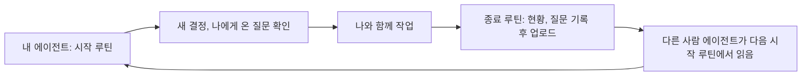
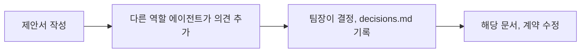

# 08. 협업 방식 (사람용)

> 상태: 해커톤 동안 운영함 · 담당: AI (팀장) · 최종 수정: 2026-11-14 · AI/Claude

11/6~11/14 동안 이 방식으로 결정 69개(D-01~D-69), 제안서와 질문 수십 건을 주고받았다. 세 명의 이름은 [README](../README.md#팀)에 있다.

에이전트용 규칙 원문은 [AGENTS.md](../AGENTS.md)에 있다. 이 문서는 사람이 이해하기 쉽게 같은 내용을 설명한다.

## 핵심 아이디어: 저장소가 단체 대화방이다

세 명은 각자 자기 AI 에이전트(Claude Code, Codex)와 일한다. 에이전트끼리는 서로 말할 수 없다.
그래서 GitHub 저장소의 파일에 질문, 제안, 현황을 남기고, 다른 사람의 에이전트가 그 파일을 읽고 답한다.

## 어떤 파일에 무엇을 쓰나

| 파일 | 무엇을 | 누가 쓰나 |
|---|---|---|
| `coordination/questions.md` | 다른 역할에게 묻고 싶은 것, 부탁 | 누구나 (맨 아래에 추가) |
| `coordination/questions-archive.md` | 끝난 질문. `questions.md`를 짧게 유지하려고 옮겨 둔다 | 팀장 (종료 루틴에서) |
| `coordination/proposals/` | 공용 문서나 계약을 바꾸자는 제안 | 누구나 (제안서 1개 = 파일 1개) |
| `coordination/decisions.md` | 확정된 결정 | 팀장만 |
| `coordination/roles/역할.md` | 내 책임과 현황 (한 일, 다음 할 일, 막힌 것, 요청) | 그 역할만 |
| `coordination/meetings/` | 회의 안건, 회의록 | 누구나 |
| `docs/`, `contracts/` | 설계 문서와 약속 | 제안 → 결정 후 수정 |

## 무언가를 바꾸는 흐름

에이전트는 결정하지 않는다. 선택지와 추천 이유만 내고, 결정은 사람(팀장)이 한다.

## 예시 상황

1. FE 팀원의 Codex가 클립 목록 화면을 만들다가 "클립마다 원본 페이지 번호가 필요하다"는 걸 알게 된다. `questions.md`에 `Q-FE-01 [to:BE]`로 남기고 종료 루틴에서 올린다.
2. 저녁에 BE 팀원이 시작 루틴을 하면, BE 에이전트가 "FE에서 질문이 왔어요"라고 알려준다. 계약을 바꿔야 하므로 `P-BE-01` 제안서를 만들어 올린다.
3. 강현이 시작 루틴을 하면, Claude가 "의견이 필요한 제안서가 있어요"라고 알려준다. 강현이 승인하면 `decisions.md`에 기록하고 계약 문서를 고친다.
4. 다음 날 FE 에이전트가 시작 루틴에서 새 결정을 보고 화면에 반영한다.

## 메신저와 파일의 관계

- 급한 일, 회의 일정, 막혀서 당장 도움이 필요한 일은 팀 메신저로 이야기한다.
- 질문이나 제안서에 답했으면 메신저로 알린다(D-15). 상대가 다음 시작 루틴을 기다리지 않고 바로 볼 수 있다.
- 이야기해서 정해진 것은 반드시 파일(결정 기록, 질문의 답)에 남긴다. **파일에 없는 결정은 다른 사람의 에이전트가 모른다.**
- 오프라인 14시간에는 옆에 앉아 직접 이야기하되, 결정은 똑같이 기록한다.

## 코드 작업 방식 (D-31, D-35)

| 무엇 | 어디에 | 어떻게 올리나 |
|---|---|---|
| 문서, 샘플 | `docs/`, `coordination/`, `samples/` | main에 바로 |
| 기능 코드 | `frontend/`(FE), `backend/`(BE), `pipeline/`(AI) | `feature/짧은-이름` 브랜치에서 만들고(FE는 `frontend` 브랜치 하나, D-37), PR 없이 각자 AI와 확인해서 main에 merge |
| 실험 코드 | `sandbox/내역할/` | main에 바로. 다른 역할이 의존하지 않는다 |

- 개발은 각자 진행한다. 다른 역할에 영향이 있는 기능은 만들기 전에 제안서로 남긴다.
- 충돌할 지점, 궁금한 점, 쟁점은 `questions.md`나 제안서에 남긴다. 같이 정할 것이 있으면 메신저로도 알린다.
- merge 전에 main을 받아 충돌을 먼저 해결한다. 다른 역할의 폴더는 고치지 않는다.

## git 충돌을 줄이는 방법

- 작업 전에는 받고(pull), 작업 후에는 바로 올린다(push). 루틴이 대신 해준다.
- 자기 역할 파일만 고친다.
- 공용 파일(`questions.md`)은 맨 아래에 추가만 한다.
- 충돌이 나면 에이전트에게 "양쪽 다 살려서 해결해줘"라고 한다.

## 같은 사람이 여러 도구를 쓸 때

강현처럼 Claude Code와 Codex를 함께 쓰면 역할은 같고 도구 표기만 다르다(`AI/Claude`, `AI/Codex`). 두 도구 모두 같은 `AGENTS.md` 규칙을 따른다.

## 이 방식도 바꿀 수 있다

써 보고 불편하면 제안서로 바꾸자. 이 문서와 AGENTS.md는 팀장이 관리한다.
